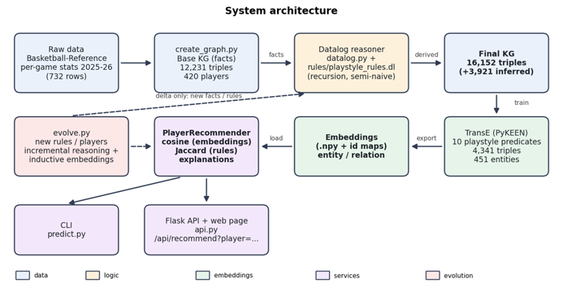
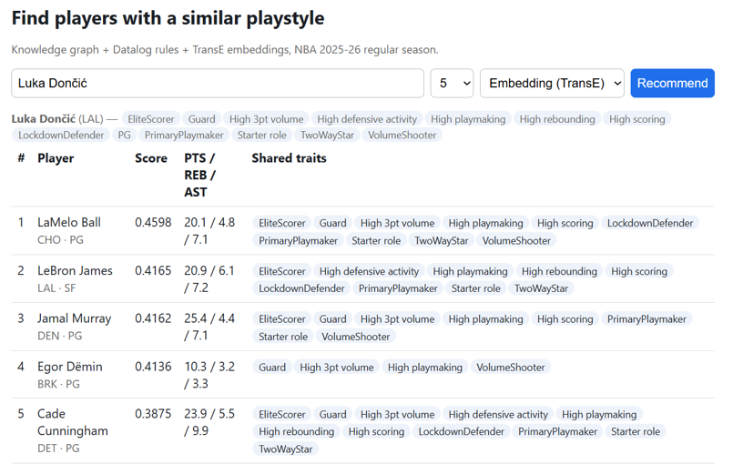
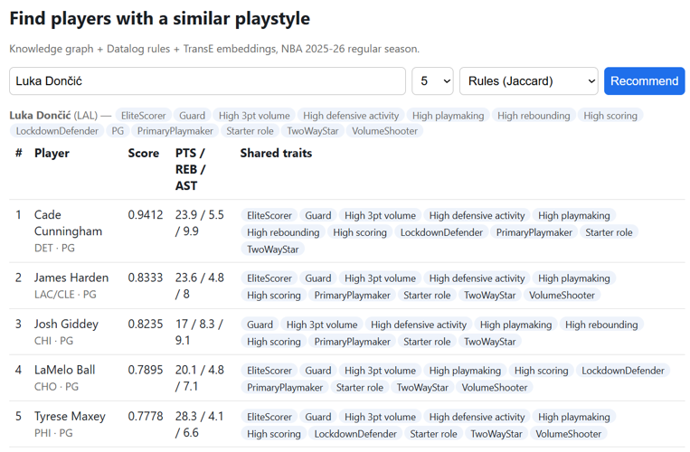

# Knowledge Graph-based Basketball Player Recommender

## Goal of the Project

Basketball fans, scouts and fantasy players often ask "who plays like X?". Answering this
question is not easy at all, because we need dozens of box-score numbers. My project builds
a knowledge graph of the NBA 2025-26 regular season per game player statistics. For a player
chosen by the user, the application returns n other players with the most similar playstyle.
The system combines Datalog rules to define archetypes, a taxonomy and skill tiers, and
a TransE embedding model is trained on these logically derived edges to obtain similarity.

## Architecture




## Quick start

```bash
pip install -r requirements.txt
python create_graph.py                                   # data/base_graph.csv            (12 231 fact triples, 420 players)
python reason.py                                         # data/final_knowledge_graph.csv (+3 921 triples inferred by rules/playstyle_rules.dl)
python train.py                                          # artifacts/                     (TransE with PyKEEN; ~2 min trainging time on CPU)
python predict.py --player "Luka Doncic" --top-n 5       # Default: TransE embedding prediction
python predict.py --player doncilu01 --method rules      # Prediction based only on rules. Works without 'train.py'
python api.py                                            # http://127.0.0.1:5000          Basic Web Page
python evolve.py --new-rules rules/rules_v2_extension.dl --new-players data/new_players_demo.csv --verify                       # Incremental evolution
```

## Screenshots

### 1) Example output with Embedding (TransE) method:



### 2) Example output with Rules (Jaccard similarity) method:


